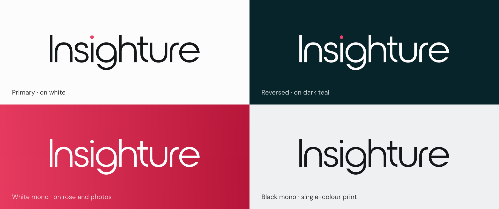

<!-- Generated by `npm run skill` in github.com/insighture/design-system. Do not edit; edit SKILL.md or references/ instead. -->

# Insighture brand guidelines

One visual system for **everything**: Word documents, PDFs, slide decks,
spreadsheets, websites, email, social posts, diagrams and charts. The React
package in this repo is just one way to apply it. The rules below work in any
medium. AI assistants get the same rules through [`SKILL.md`](SKILL.md).

---

## 1. The look and the voice

### The look in one paragraph

Confident, warm and modern, as on [insighture.com](https://www.insighture.com).
Content sits on white, set in black **DM Sans**. **Crimson rose** is the brand's
signature: a rose-gradient hero or call-to-action band, the one key action, or
one or two headline words set in **DM Serif Display italic**. **Dark teal** is
the brand ground for covers, title slides, testimonial sections and dark mode.
The alt colours (teal, orange, yellow, indigo) only appear where things need
telling apart, as in charts, categories, card accents and illustrations.
Rounded shapes (pill buttons, 18px cards), generous space, and nothing
decorative that doesn't carry meaning.

### Voice

For any copy written into a piece of work:

- Plain, confident, specific. Short sentences, active voice.
- Headlines make a claim: "We own the problem, not just *the solution.*"
- No hype words ("revolutionary", "cutting-edge", "synergy") and no
  exclamation marks.
- Australian/British spelling (colour, organisation).
- Sentence case for headings and buttons.

---

## 2. Colour

### Main palette

| Name | Hex | RGB | Use it for |
| --- | --- | --- | --- |
| White | `#FCFCFD` | 252 252 253 | Pages, slides, surfaces, text on dark |
| Black | `#15181A` | 21 24 26 | Body text, headings, the strongest button on light |
| Dark teal | `#08242B` | 8 36 43 | Grounds only: covers, title/section slides, hero bands, footers, dark mode |
| Crimson rose | `#EE4065` | 238 64 101 | The accent: key number, key word, primary call to action, highlights |

### Alt palette

| Name | Hex | RGB | Use it for |
| --- | --- | --- | --- |
| Teal | `#0FA2BF` | 15 162 191 | Support and info, second data series, links on dark |
| Orange | `#FF8102` | 255 129 2 | Categorical colour, illustration |
| Yellow | `#FAB400` | 250 180 0 | Warning, highlight marker, categorical colour. Never text. |
| Indigo | `#4F46E5` | 79 70 229 | Categorical colour, data, eyebrows |

### Functional colours (not brand colours)

| Role | Hex | Use |
| --- | --- | --- |
| Success | `#17A06A` | Status only: dots, icons, ticks |
| Danger | `#D93A2B` | Status only: errors, destructive actions. Deliberately more orange than rose, so it never reads as the accent. |

### Neutrals (most of every page)

`#FCFCFD` · `#F6F7F8` · `#EEF0F1` · `#E1E4E6` · `#CBD0D3` · `#9EA5AA` ·
`#6B7278` · `#555C62` · `#3E4449` · `#2A2E32` · `#1D2023` · `#15181A`

Text: primary `#15181A`, secondary `#555C62`, muted `#6B7278`. Rules and
borders: `#E1E4E6` (subtle) and `#CBD0D3` (default). Tinted panels: `#EEF0F1`.
Rose tint (key-cell highlight): `#FCF0F3`.

### On dark teal

| Role | Hex |
| --- | --- |
| Ground | `#08242B` |
| Raised panel / card | `#0C2E36` |
| Subtle fill | `#12383F` |
| Rule / border | `#1A4450`, `#23525E` |
| Text primary | `#FCFCFD` |
| Text secondary | `#A9C0C5` |
| Text muted | `#7E9AA1` |
| Accent | `#EE4065` (fills), `#F58AA1` (small text) |
| Support | `#55D8F2` |

### Gradients: two, with two jobs

- **Rose gradient** `linear-gradient(90deg, #E63A5F 0%, #B61639 100%)` is a
  *surface*: hero and CTA bands with white text and white or outlined pill
  buttons on top.
- **Brand gradient** (rose → orange → yellow) is *decoration only*: thin cover
  strips and dividers, never behind text.

No other gradients, and no purple-to-blue "AI" gradients.

### Proportion

Roughly, by area, on any page or slide:

```
White / Black / neutrals  ███████████████████████████████████  ~75%
Dark teal                 ███████                               ~15%  (covers, bands, dark slides)
Crimson rose              ██                                    ~5%   (one element per view, or one hero/CTA band)
Alt colours               ██                                    ~5%   (charts, categories)
```

### The rules

1. **One rose moment per view.** One per page, slide, section or screen: a
   rose-gradient hero or CTA band, the key figure, the call to action, or the
   serif-italic headline words. If two things are rose, neither is important.
2. **Dark teal is a ground, not a decoration.** Use it as full backgrounds or
   bands. Don't use it for small text or thin lines on white.
3. **Alt colours are for telling things apart.** Charts, categories, tags,
   illustrations and diagrams. They never replace rose as the accent, and
   they're never large surfaces.
4. **Status colours are small.** A dot, an icon or a thin bar, never a filled
   coloured box or coloured body text. Tags and badges are neutral with a
   coloured dot.
5. **No hex values outside this palette.** No default Tailwind, Material or
   Office palettes. `brand/palette.json` lists every allowed hex by token
   name; `brand/tokens.css` has the full token set.

### Contrast (WCAG AA)

| Pair | Ratio | OK for |
| --- | --- | --- |
| Black on white | 17.4:1 | Everything |
| White on dark teal | 15.8:1 | Everything |
| White on rose | 3.8:1 | Bold text ≥ 14pt / 18px, buttons, large headings. **Not small body text.** |
| Rose `#B11032` on white | 6.9:1 | Small accent text on white (use this, not `#EE4065`) |
| Rose `#F58AA1` on dark teal | 7.0:1 | Small accent text on dark teal |
| Teal `#0FA2BF` on white | 3.0:1 | Fills and icons only. For text, use `#0A5D7A`. |
| Yellow `#FAB400` on white | 1.8:1 | Fills only. Never text. |

---

## 3. Typography

Two families, both free on Google Fonts (SIL Open Font License):

- **DM Sans** for everything: headings, body, tables, UI, captions and slides.
  Where it may be missing (shared Office files, email), fall back to **Arial**.
- **DM Serif Display, italic**, the emphasis face. Only for one or two words
  *inside* a headline: "We own the problem, not just *the solution*",
  "AWS Advanced *partners*". Regular weight, in rose on white, white on rose
  or dark teal, or rose on dark teal. Fallback **Georgia Italic**. Once per
  title. Never body text, whole headlines, buttons or labels.

Never Calibri, Times, Cambria, Inter, Roboto, or any other face.

| Weight | Use |
| --- | --- |
| 400 Regular | Body copy, intro paragraphs |
| 500 Medium | UI labels, buttons, emphasis inside body |
| 600 Semibold | **All headings and titles**, table headers, eyebrows |
| 700 Bold | Key figures, names in testimonials, rare extra weight |

Headings are semibold, not bold (in Office, which only reliably has regular
and bold, use Bold). Letter-spacing tightens as size grows, to about
`-0.025em` at display sizes.

**Eyebrows** (the small label above a title): 11–12pt, uppercase, semibold,
`+0.1em` tracking, in indigo, teal or rose on light; teal on dark.

### Type scales by medium

| Role | Web (px) | Document (pt) | Slides 16:9 (pt) |
| --- | --- | --- | --- |
| Display / cover title | 48–60 | 28 | 54 |
| Title / H1 | 36 | 20 | 36 |
| H2 | 28 | 15 | 22 |
| H3 | 22 | 12 | 18 (semibold) |
| Body | 16 | 10.5 | 18 |
| Small / table | 14 | 9 | 14 |
| Caption / footnote | 12 | 8 | 11 |

Line height: 1.5 body, 1.2–1.25 headings, 1.0–1.1 display. Paragraph spacing
about half a line, not a blank line.

### Getting the fonts

- **Web:** load both as a weight **range**, or 500/600 silently render as 400:
  `https://fonts.googleapis.com/css2?family=DM+Sans:ital,opsz,wght@0,9..40,100..1000;1,9..40,100..1000&family=DM+Serif+Display:ital@0;1&display=swap`
- **Office / Keynote:** install the **static** DM Sans files and DM Serif
  Display locally before using the templates (`templates/README.md`).
- **PDF:** embed DM Sans.

---

## 4. Space, shape and layout

- **Grid:** 4px base. Steps of 4 · 8 · 12 · 16 · 24 · 32 · 48 · 64 · 96.
  Between blocks, 16/24/32 is the default.
- **Radius:** pill for buttons, tags and toggles; 6 for small chips and
  inputs; 18 for cards, panels and image frames; 48 for large feature panels.
  Round icon buttons and avatar circles. Same radius at the same level
  throughout one piece of work.
- **Elevation:** soft and rare. A 1px `#E1E4E6` border **or** a faint shadow
  (`0 1px 3px rgba(21,24,26,.09)`), never both, never hard drop shadows.
- **Alignment:** left-aligned text, ragged right. Centre only short titles on
  covers.
- **Margins:** documents ≥ 20mm (A4) / 0.75in (Letter). Slides ≥ 0.5in safe
  area. Web content max width 72rem (1152px), ~68 characters for prose.
- **Section rhythm (web, long documents):** alternate white sections with
  dark teal ones; use a rose-gradient band for the hero or the closing call
  to action. Never two rose bands next to each other.
- **Cards:** white, 18px radius, a soft shadow or a 1px `#E1E4E6` border,
  24–32px padding. An optional tinted icon tile (40–56px, 10px radius, alt
  colour at ~15% tint) sits top-left. Each card in a set may take its own alt
  colour for its icon and "Learn more ›" link.
- **White space is the brand.** When in doubt, remove an element rather than
  shrink everything to fit.

---

## 5. Applying it, by medium

Start from the ready-made files in [`templates/`](templates/README.md) (PowerPoint, Word,
PDF, email and social) rather than a blank document.

---

### Documents (Word, Google Docs, PDF reports, letters)

**Start from a template**, not a blank document:

| Need | File |
| --- | --- |
| Report | `templates/word/Insighture-report.dotx`: rose cover, header/footer, every brand style incl. the *Serif Emphasis* character style |
| Letter or memo | `templates/word/Insighture-letterhead.dotx` |
| Worked example | `templates/word/Insighture-report-sample.docx` |
| PDF report / one-pager | `templates/pdf/Insighture-report.pdf`, `Insighture-one-pager.pdf`; editable HTML sources in `templates/pdf/src/` |

If you must generate from scratch (python-docx, docx.js), match the template:

- Page: white `#FCFCFD` (pure white `#FFFFFF` is fine in print). Body DM Sans
  10.5pt, `#15181A`, line spacing 1.3, 6pt after paragraphs.
- Headings: DM Sans semibold (Bold in Office), black. H1 20pt, H2 15pt,
  H3 12pt. Optional 11pt rose or indigo uppercase eyebrow above H1. The title
  may set one or two words in DM Serif Display italic, in rose.
- **Cover:** full-bleed dark teal `#08242B` or rose-gradient page, or a top
  band ≥ ⅓ of the page. White title 28–36pt semibold with an optional serif
  italic word; secondary text `#A9C0C5` on teal, white at 85% on rose. Logo
  top-left in the right version (`references/logo.md`).
- **Tables:** header fill `#EEF0F1`, header text 9pt semibold uppercase
  `#555C62`; body 9–10pt; horizontal rules only, `#E1E4E6` 0.5pt; zebra rows,
  if any, `#F6F7F8`.
- **Callouts:** a `#EEF0F1` box, no border, a small coloured marker or icon.
  Key takeaway: a dark teal box with white text, at most one per page.
- **Footer:** 8pt muted grey, page numbers on the right.
- Margins ≥ 20mm. PDFs embed DM Sans.

---

### Presentations (PowerPoint, Keynote, Google Slides)

**Start every deck from `templates/powerpoint/Insighture.potx`.** Layouts:
Title (rose), Section (dark teal), Title and Content, Two Content, Title Only,
Big Number, Quote, Closing. `templates/powerpoint/Insighture-sample.pptx`
shows nine worked slides.

Generating from scratch (pptxgenjs, python-pptx)? Replicate the theme:

| Slot | Hex | | Slot | Hex |
| --- | --- | --- | --- | --- |
| dk1 | `#15181A` | | accent2 | `#0FA2BF` |
| lt1 | `#FCFCFD` | | accent3 | `#FF8102` |
| dk2 | `#08242B` | | accent4 | `#FAB400` |
| lt2 | `#EEF0F1` | | accent5 | `#4F46E5` |
| accent1 | `#EE4065` | | accent6 | `#555C62` |
| hyperlink | `#15181A` | | fonts | DM Sans (major and minor) |

- 16:9.
- **Title / closing:** rose-gradient ground (`#E63A5F → #B61639`), white
  54–58pt semibold title with one or two words in white DM Serif Display
  italic (bold off), white subtitle, a white pill for the date or CTA,
  white-mono logo.
- **Section / quote:** dark teal ground, white title, rose serif-italic key
  word, teal or rose uppercase eyebrow, reversed (white, rose-dot) logo.
- **Content:** white ground, 12pt uppercase eyebrow, black 32–36pt semibold
  title (optional rose serif word), body 18pt `#3E4449`, small black logo
  bottom-left (~0.24in tall).
- **Big number:** the figure in rose 72–120pt semibold, a black or white
  label beneath.
- One rose element per slide, ≤ 6 bullets, one idea per slide, ≥ 40% of the
  slide empty. No clip-art, bevels, 3D, heavy shadows or stock "AI" imagery.
- Charts on slides follow `references/charts.md`.

---

### Web: HTML pages, Claude artifacts, React, dashboards

#### Which route

1. **React codebase with `@insighture/design-system`:** import
   `@insighture/design-system/styles.css`, wrap the app in
   `<InsightureProvider defaultTheme="light">` (nothing is styled without it:
   it sets `data-ins-theme`, which the token layer keys off), and use its
   components. Index: `references/components.md`; each component's API and
   guidance is in `docs/<Component>.md`. Don't restyle them with raw hex.
2. **Any other HTML or framework:** use `brand/tokens.css` (the full token set:
   primitives plus light and dark-teal semantic roles, `--ins-*`).
3. **No files available:** the minimum below.

```html
<link href="https://fonts.googleapis.com/css2?family=DM+Sans:ital,opsz,wght@0,9..40,100..1000;1,9..40,100..1000&family=DM+Serif+Display:ital@0;1&display=swap" rel="stylesheet">
<style>
:root {
  --ins-font-sans: 'DM Sans', ui-sans-serif, system-ui, -apple-system, 'Segoe UI', Roboto, Arial, sans-serif;
  --ins-font-serif: 'DM Serif Display', Georgia, serif;
  --ins-gradient-rose: linear-gradient(90deg, #E63A5F 0%, #B61639 100%);
  --ins-white: #FCFCFD; --ins-black: #15181A; --ins-deep-teal: #08242B; --ins-rose: #EE4065;
  --ins-teal: #0FA2BF; --ins-orange: #FF8102; --ins-yellow: #FAB400; --ins-indigo: #4F46E5;
  --ins-text: #15181A; --ins-text-2: #555C62; --ins-text-3: #6B7278; --ins-text-accent: #B11032;
  --ins-border: #E1E4E6; --ins-bg-subtle: #EEF0F1; --ins-radius-card: 18px;
}
@media (prefers-color-scheme: dark) { :root {
  --ins-white: #08242B; --ins-black: #FCFCFD; --ins-text: #FCFCFD; --ins-text-2: #A9C0C5; --ins-text-3: #7E9AA1;
  --ins-text-accent: #F58AA1; --ins-border: #1A4450; --ins-bg-subtle: #12383F;
} }
body { font-family: var(--ins-font-sans); background: var(--ins-white); color: var(--ins-text); }
h1, h2, h3 { font-weight: 600; letter-spacing: -0.025em; }
h1 em, h2 em { font-family: var(--ins-font-serif); font-style: italic; font-weight: 400; color: var(--ins-rose); }
</style>
```

#### Rules

- Load the fonts as a weight **range** (as above) or 500/600 silently render
  as 400.
- **Dark mode is dark teal**, not black or grey. Light and dark are both
  first-class.
- **Buttons are pills.** On light: primary black, emphasis rose (one per
  page). On dark teal: primary rose, emphasis white. On rose: white filled
  with rose text, or outlined white.
- **Hero:** a rose-gradient band with a white 48–60px semibold heading, one
  white serif-italic phrase, and a white pill CTA ("Let's talk") with rose
  text. Or dark teal with a rose serif word.
- Section headings on white: black semibold with a rose serif-italic phrase
  ("Great outcomes start with the *right thinking.*").
- **Links in prose:** black with an underline, rose on hover; on dark, white
  with an underline.
- Logo top-left in the header, inlined as SVG (`references/logo.md`).
- Page rhythm, cards and radii: `references/layout.md`. Charts:
  `references/charts.md`.

---

### Spreadsheets (Excel, Sheets)

- DM Sans 10pt (Arial fallback).
- **Header row:** fill `#EEF0F1`, bold black, bottom border `#CBD0D3`, frozen.
- Numbers right-aligned with consistent formats. Negatives in danger red
  `#D93A2B` only where the sign actually matters.
- **Key cell or row:** `#FCF0F3` fill with rose bold text, once per sheet.
- Status via icon sets or data bars, not full-cell fills.
- Gridlines off on presentation sheets.
- Charts follow `references/charts.md`; no default Office theme colours left
  anywhere.

---

### Charts and diagrams

- **Series order:** rose `#EE4065` → dark teal `#08242B` → teal `#0FA2BF` →
  yellow `#FAB400` → indigo `#4F46E5` → orange `#FF8102`. On a dark ground,
  white replaces dark teal. Prefer fewer series over more colours.
- **Spotlight:** the series or bar that matters in rose, the rest `#9EA5AA`
  (or `#3E4449`).
- Gridlines `#E1E4E6` hairline; axis labels 10–11pt `#6B7278`.
- No 3D, chart borders or gradient fills. Label data directly; a legend only
  if labels can't sit on the data.
- **Diagrams:** black 1.5px strokes, `#EEF0F1` boxes with 10–16px radius, a
  dark teal fill for the focal node, rose for the single critical path.

---

### Email and social

#### Email

Start from `templates/email/newsletter.html` (table layout, inline styles,
font fallbacks).

- 600px column, white body.
- Header band: rose gradient with a solid `#EE4065` fallback, or dark teal.
- DM Sans with an Arial fallback.
- One rose pill button: semibold 16px, white text.
- Images by absolute URL.

#### Social

Examples: `templates/social/linkedin-1200x627.png`, `quote-1080x1080.png`,
`stat-1080x1350.png`.

- Rose-gradient or dark teal ground, white semibold headline with one
  serif-italic word.
- Soft circular shapes are the only decoration.
- Text on ≤ 25% of the image area.
- Sizes: LinkedIn 1200×627, square 1080×1080, portrait 1080×1350.

---

## 6. Logo



The logo is the lowercase **insighture** wordmark with a crimson-rose dot on
the *i*. Use the supplied files. **Never retype the wordmark in a font,
redraw it, or invent a logo mark.** If no file is available, use the inline
SVG in the appendix of `SKILL.md`.

| Version | Wordmark / dot | File | Use it on |
| --- | --- | --- | --- |
| **Primary** | `#15181A` / `#EE4065` | `brand/logo/insighture-logo-black.svg` | White and light neutral grounds. The default. |
| **Reversed** | `#FCFCFD` / `#EE4065` | `brand/logo/insighture-logo-white.svg` | Dark teal and black grounds. |
| **White mono** | `#FCFCFD` / `#FCFCFD` | `brand/logo/insighture-logo-white-mono.svg` | Rose and rose-gradient grounds (where the rose dot would disappear), photographs. |
| **Black mono** | `#15181A` / `#15181A` | `brand/logo/insighture-logo-black-mono.svg` | Single-colour print, engraving, and where rose can't be reproduced. |

Transparent 1420 × 336 PNGs for Office, PDF and email:
`templates/assets/logo-black.png`, `logo-white.png`, `logo-white-mono.png`.

- **Clear space:** at least half the logo's height on every side, free of text
  and graphics.
- **Minimum size:** 80px wide on screen, 20mm in print.
- **Placement:** top-left by default on covers, slides, letterheads and
  pages. In running headers and slide footers, small (about 6mm / 0.24in
  tall) at the left margin.
- **In HTML:** inline the SVG so it never depends on a network request.

**Don't:**
- recolour the wordmark or the dot beyond the four versions;
- put a rose-dot version on rose (use white mono);
- stretch, condense, rotate, outline or add shadows or glows;
- place it on busy imagery without contrast (use white mono on a dark area
  of the photo, or don't use it there);
- lock it up with other text or logos without a clear-space gap.

---

## 7. Check before you ship

### Run the brand checker

If you can run code and produced a file (.pptx, .docx, .xlsx, .html, .svg,
.css, .pdf), run the checker and fix every **ERROR**; review each
**WARNING**:

```bash
python3 scripts/check_brand.py output.pptx      # --json for machine-readable output
```

Python 3, no dependencies. It flags off-palette colours (with the nearest
brand colour), non-brand fonts, a missing or redrawn logo, more than one rose
shape per slide, long serif runs and unloaded web fonts. It can't judge
layout, so also go through the list.

### The list

- [ ] Only DM Sans, plus DM Serif Display italic for one or two headline
      words (Arial / Georgia as fallbacks).
- [ ] Neutrals carry the page; dark teal appears only as a ground.
- [ ] Exactly **one** rose moment per page, slide or view.
- [ ] Headings semibold; buttons pills; cards 18px radius.
- [ ] Alt colours only to distinguish things; status as dots or icons.
- [ ] Small text meets contrast: no `#EE4065`, teal or yellow body text on
      white.
- [ ] 4px spacing grid, consistent radii, no heavy shadows.
- [ ] The real logo, in the right version for its ground, at or above
      minimum size, with clear space.
- [ ] No hex values outside the palette; no default theme colours left in
      Office files or charts.
