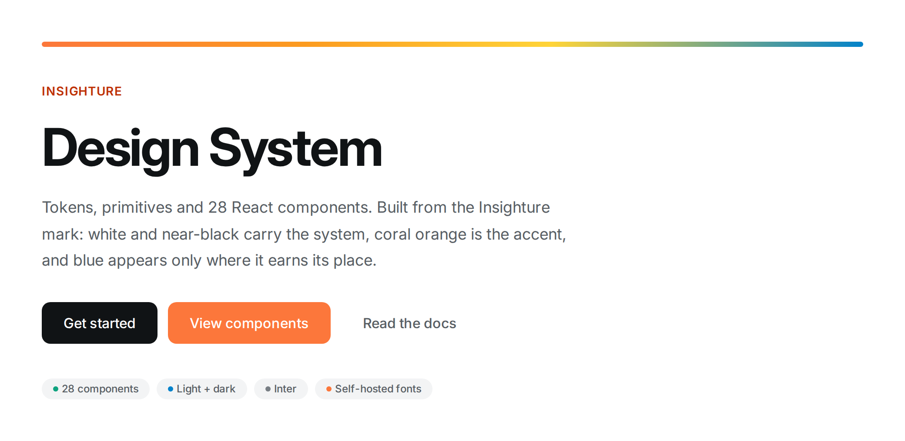
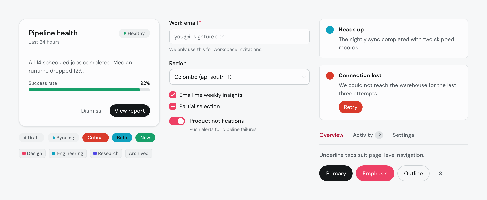
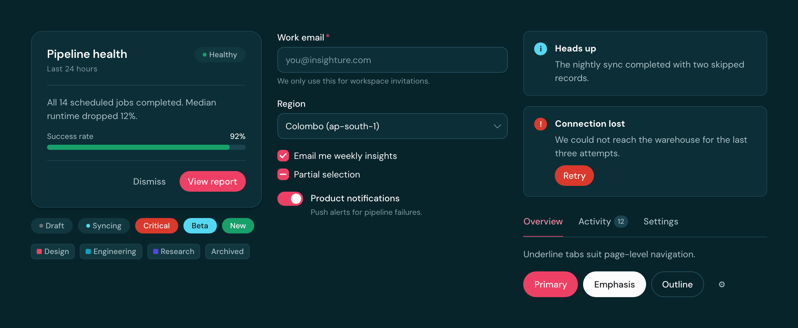
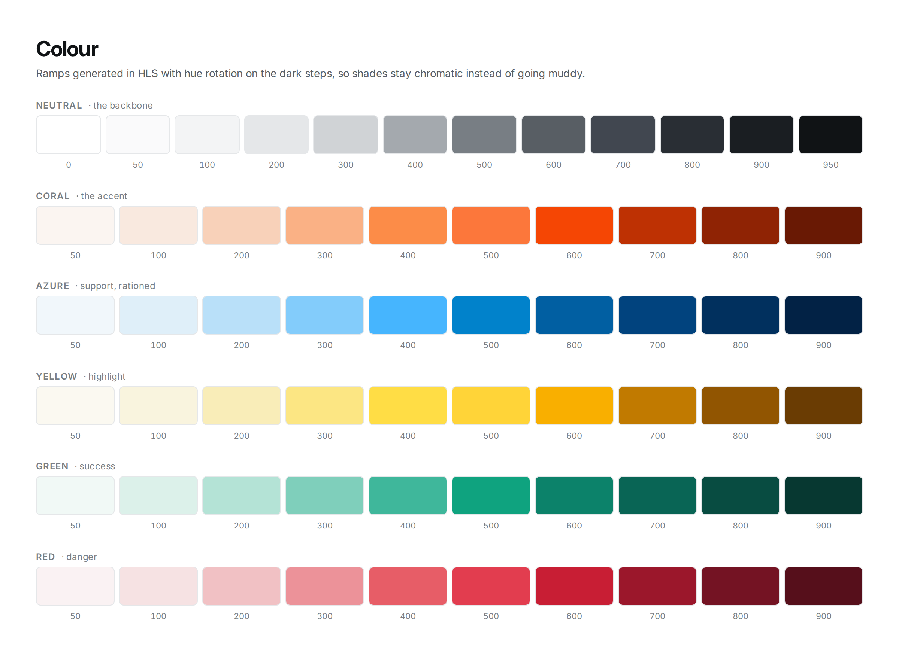

<div align="center">



<p>
  
  
  
  
  
</p>

**One brand system for documents, presentations, websites and everything else.**<br>
Colour, type and layout rules for any medium, plus tokens and 28 React components for the web.

</div>

---

## Start here: [GUIDELINES.md](GUIDELINES.md)

The brand guidelines are the system. They cover colour, type, space and
per-medium rules for **Word/PDF documents, slide decks, spreadsheets, websites,
charts, email and social**. Everything below is the web implementation of
those rules.

## The system at a glance

Every image below is rendered from the **real compiled components** — not
mockups — so they cannot drift from what the library actually ships.





Light and dark are both first-class, and the dark theme is the brand dark teal.
Note the button hierarchy inverting between them: on white the strongest action
is black, and on dark teal it's rose, because black disappears against a dark
ground. That runs through dedicated
`--ins-button-*` tokens, so the swap never drags the rest of the accent system
with it.

## Install and use

```bash
npm install
npm run build          # dist/ (ESM + CJS + .d.ts + index.css)
npm run preview        # local showcase on http://127.0.0.1:5273
npm run typecheck
npm run readme:assets  # re-render the images in this README
```

`readme:assets` bundles `src/` and screenshots the scenes in
`scripts/readme-scenes/`, so the images above are always generated from the
current components rather than maintained by hand.

```tsx
import { InsightureProvider, Button, Card, Heading } from '@insighture/design-system';
import '@insighture/design-system/styles.css';

export function App() {
  return (
    <InsightureProvider defaultTheme="light">
      <Card>
        <Heading level={2}>
          We own the problem, not just <em>the solution.</em>
        </Heading>
        <Button variant="emphasis">Let's talk</Button>
      </Card>
    </InsightureProvider>
  );
}
```

`InsightureProvider` is required. It sets `data-ins-theme`, which is what the
token layer keys off — components rendered outside a provider are unstyled.
The `<em>` inside `Heading` renders in DM Serif Display italic, in rose.

## Beyond the web

The same system drives everything else. [GUIDELINES.md](GUIDELINES.md) has
the full rules; the essentials:

| Medium | Ground | Type | Signature move |
| --- | --- | --- | --- |
| Word / PDF | White pages; dark teal or rose-gradient cover | DM Sans 10.5pt body, H1 20pt semibold | One or two title words in rose DM Serif Display italic |
| Slides (16:9) | Rose-gradient title slide, dark teal section slides, white content slides | Title 36pt semibold, body 18pt | White serif-italic words on rose; one rose moment per slide |
| Excel | White, `#EEF0F1` header row | DM Sans 10pt | Key cell in rose on `#FCF0F3` |
| Charts | White or dark teal | DM Sans 10–11pt labels | Series: rose → dark teal → teal → yellow → indigo → orange |
| Email / social | Rose-gradient or dark teal band | DM Sans, Arial fallback | Rose pill button; one serif italic word |

For generated Office files, `tokens.ts` exports `officeTheme` (dk1/lt1/
accent1–6, fonts) and `mediaType` (pt scales) so code can apply the theme
directly. Where the fonts can't be embedded, fall back to **Arial** for DM Sans
and **Georgia Italic** for DM Serif Display.

### Fonts

Both families are free on Google Fonts under the SIL Open Font License:
[DM Sans](https://fonts.google.com/specimen/DM+Sans) and
[DM Serif Display](https://fonts.google.com/specimen/DM+Serif+Display). Install
them locally for Word, PowerPoint and Keynote work. The package self-hosts
latin subsets in `src/styles/fonts/`, so web pages need no network font
request.

## The palette



Four main colours and four alts. Rose, teal and the alts sit at step 500 of their ramps; dark teal is `deep-900`; white and black are `neutral-0` and `neutral-950`.

| | Colour | Hex | Role |
| --- | ------ | --- | ---- |
| Main | White | `#FCFCFD` | Pages, slides, surfaces. Most of everything. |
| Main | Black | `#15181A` | Text, headings, the strongest action on light. |
| Main | Dark teal | `#08242B` | The brand ground: dark theme, covers, section slides, testimonial bands. |
| Main | Crimson rose | `#EE4065` | **The** accent: one rose moment per view (a gradient hero/CTA band, the key action, or the serif-italic headline words), plus focus and selection. |
| Alt | Teal | `#0FA2BF` | Support / info, second data series. |
| Alt | Orange | `#FF8102` | Categorical, illustration. |
| Alt | Yellow | `#FAB400` | Warning, highlight, categorical. |
| Alt | Indigo | `#4F46E5` | Categorical, data. |
| Functional | Green `#17A06A`, red `#D93A2B` | | Success / danger status only. Red leans orange so it never reads as rose. |

The restraint is enforced by the token layer: alt colours are reachable from
components only through `--ins-support-*`, `--ins-info-*`, `--ins-warning-*`
and the `Tag` swatches, so nothing casually turns teal or indigo. Changing the
accent is an edit to the `--ins-accent-*` block in `semantic.css` and nothing
else.

- **The ramps hold each brand hex exactly** (500 for rose and the alts). Lighter steps are tints toward
  white, and darker steps keep their saturation (warm hues rotate slightly
  toward red), so shades stay chromatic instead of going muddy.
- **A dedicated dark-teal ramp** (`--ins-deep-*`) builds the dark theme's
  canvas, surfaces, borders and secondary text, so dark mode reads as brand
  rather than generic charcoal.
- **Neutrals are slightly cool** and run from brand white to brand black, so
  greys sit beside dark teal without looking warm.
- **Contrast:** white on rose is 3.8:1, which is fine for buttons and large
  text. Small accent text uses `--ins-text-accent` (`#B11032` on light,
  `#F58AA1` on dark). The serif emphasis uses full rose, so keep it to
  headings at `size="md"` (28px) and up.

## Type and shape

Matched to [insighture.com](https://www.insighture.com):

- **DM Sans** for everything, with **semibold** headings tracking down to
  -0.025em at display size.
- **DM Serif Display italic** for one or two emphasis words per headline.
  Write `<em>` inside a `Heading`: `<Heading>Great outcomes start with the
  <em>right thinking.</em></Heading>`.
- **Pill buttons**, 18px cards, 48px feature panels.
- **`--ins-gradient-rose`** (`#E63A5F → #B61639`) for hero and
  call-to-action bands.

## Tokens

Three layers, in this order:

1. **Primitives** (`src/styles/tokens.css`) — raw palette ramps, type scale,
   space, radius, elevation, motion. Prefixed `--ins-*`.
2. **Semantic** (`src/styles/semantic.css`) — role-named aliases per theme, e.g.
   `--ins-bg-surface`, `--ins-text-secondary`, `--ins-accent-bg`.
3. **Components** — consume semantic tokens only. That indirection is what makes
   a theme swap change the whole system at once.

Never reference a primitive from a component. If a role is missing, add it to the
semantic layer for both themes.

`src/tokens.ts` mirrors the values in TypeScript for places CSS custom
properties can't reach: charts, canvas, email, and generated Word, PowerPoint
and PDF files.

- `brand`: the eight colours.
- `palette`: every ramp, including `deep` (dark teal) and `neutral`.
- `chartSeries`: a ready-ordered categorical sequence.
- `roseGradient` / `brandGradient`: the hero-band surface and the decorative
  strip.
- `typography`, `space`, `radius`: the web scales.
- `mediaType`: pt type scales for documents and 16:9 slides.
- `officeTheme`: the dk1/lt1/accent1–6 + fonts mapping to apply as a Word,
  PowerPoint or Excel theme.

## Themes

`light` on white, `dark` on the brand dark teal. Both are
first-class — every component is styled for each.

```tsx
<InsightureProvider theme={theme} onThemeChange={setTheme}>   // controlled
<InsightureProvider defaultTheme="dark">                       // uncontrolled

const { theme, toggleTheme } = useInsightureTheme();           // inside the tree
```

## Components

| Group        | Components                                              |
| ------------ | ------------------------------------------------------- |
| Foundations  | `InsightureProvider`, `Stack`, `Divider`                 |
| Typography   | `Heading`, `Text`, `Link`                                |
| Actions      | `Button`, `IconButton`                                   |
| Data display | `Badge`, `Tag`, `Card` (+`Header`/`Body`/`Footer`), `Avatar` |
| Feedback     | `Alert`, `Spinner`, `Progress`                           |
| Forms        | `Input`, `Textarea`, `Select`, `Checkbox`, `Radio`, `RadioGroup`, `Switch` |
| Navigation   | `Tabs`, `Tooltip`, `Modal`                               |

Conventions across the set:

- **Tone vs colour.** `Badge`/`Alert`/`Progress` take a semantic `tone`
  (`success`, `danger`, …). `Tag` takes a `color` named after the palette
  (`rose`, `teal`, `orange`, `yellow`, `indigo`, `neutral`) because tags are
  categorical, not status.
- **Form controls own their labels.** Pass `label`, `hint` and `error` to the
  control; `htmlFor`, `aria-describedby` and `aria-invalid` are wired for you.
  Setting `error` also flips the field into the invalid state.
- **Controlled and uncontrolled.** `Tabs`, `RadioGroup` and `InsightureProvider`
  accept `value`/`defaultValue` with an `on*Change` callback.
- **Buttons are pills.** Use one `Button variant="primary"` per view (black
  on light, rose on dark teal), and save `variant="emphasis"` (rose on light,
  white on dark teal) for the single strongest action on a page.
- **Accent restraint.** One rose moment per view. Reach for neutrals first;
  colour is the exception, not the default.

## Styling your own layout

Compose with `Stack` (flex wrapper over the space scale) and reach for the
custom properties directly in your own CSS:

```css
/* A rose call-to-action band, as on insighture.com */
.cta-band {
  display: flex;
  align-items: center;
  justify-content: space-between;
  gap: var(--ins-space-lg);
  padding: var(--ins-space-2xl) var(--ins-space-xl);
  background: var(--ins-gradient-rose);
  color: var(--ins-brand-white);
  border-radius: var(--ins-radius-2xl);
}

/* A feature card */
.feature-card {
  padding: var(--ins-space-xl);
  background: var(--ins-bg-surface);
  border-radius: var(--ins-radius-lg);
  box-shadow: var(--ins-shadow-card);
}
```

Don't hardcode hex values in web code; every colour you need has a token.

## Migrating from the previous palette

The coral / azure / Inter system was replaced in `0aedaf4`:

- `Tag` colours `coral`, `azure`, `amber` and `green` are now `rose`, `teal`,
  `orange`, `yellow` and `indigo`.
- `--ins-azure-*`, `--ins-ink-*`, `--ins-orange-amber`, `--ins-brand-coral`,
  `--ins-brand-azure`, `--ins-brand-navy` and `--ins-brand-amber` are gone.
  Use `--ins-teal-*`, `--ins-deep-*` and the new `--ins-brand-*` names.
- `tokens.ts` `brand` keys are now `white`, `black`, `deepTeal`, `rose`,
  `teal`, `orange`, `yellow` and `indigo`.
- Headings are semibold, buttons are pills, and the font is DM Sans. Nothing
  to change in code, but screenshots and visual tests will differ.

## Layout of the repo

```
src/
  index.ts                 package entry (also imports the stylesheet)
  tokens.ts                TS mirror of the token values
  styles/                  font, primitives, semantic, base, stylesheet barrel
  components/<Name>/       one .tsx + one .css per component
GUIDELINES.md              brand guidelines for every medium: start here
docs/                      per-component docs (also drive the design-system sync)
docs/assets/               the README images, rendered from the real bundle
preview/                   local showcase app, not published
scripts/fetch-fonts.mjs    refreshes the self-hosted DM Sans + DM Serif Display subsets
.design-sync/              inputs for the claude.ai/design sync
```

Adding a component: create `src/components/<Name>/`, add its stylesheet to
`src/styles/index.css`, and export it from `src/index.ts`.
